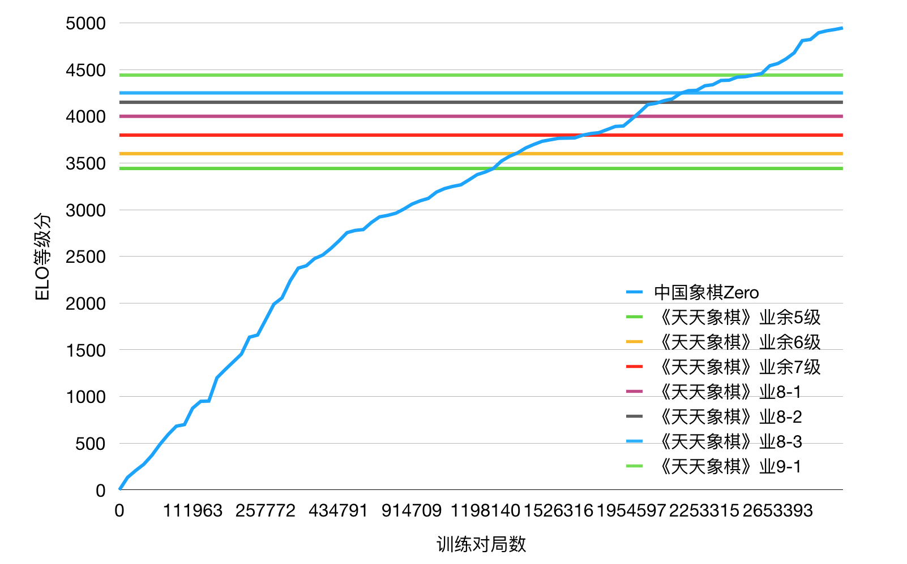
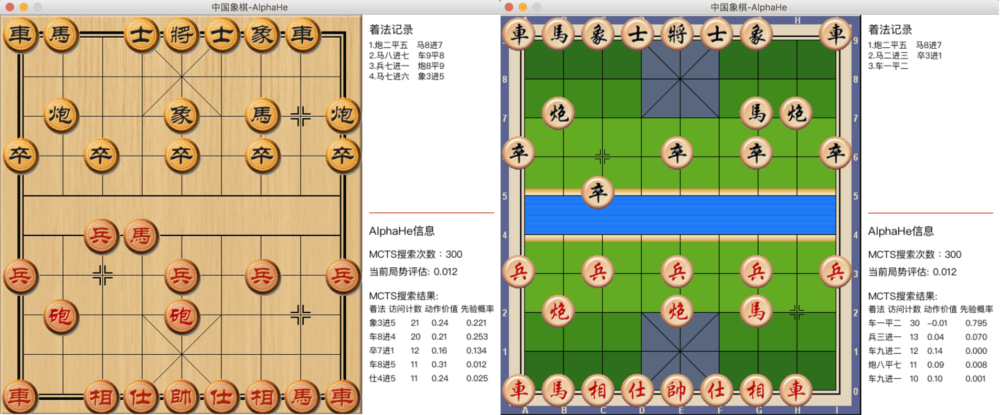

# CCZero advanced

本项目在原项目的基础上经过修改和优化，兼容 Python 3.12 及 3.13 版本。

还添加了用GUI看ai斗蛐蛐的功能。

目前只能使用CPU。

特别感谢原作者 `NeymarL` 。

原始 README：

---

# 中国象棋 Zero（CCZero）

<a href="https://cczero.org">
  
</a>

## 关于

使用 [AlphaZero](https://arxiv.org/abs/1712.01815) 方法进行中国象棋强化学习。

本项目基于以下主要资源：
1. DeepMind 10 月 19 日发布的论文：[Mastering the Game of Go without Human Knowledge](https://www.nature.com/articles/nature24270.epdf?author_access_token=VJXbVjaSHxFoctQQ4p2k4tRgN0jAjWel9jnR3ZoTv0PVW4gB86EEpGqTRDtpIz-2rmo8-KG06gqVobU5NSCFeHILHcVFUeMsbvwS-lxjqQGg98faovwjxeTUgZAUMnRQ)。
2. @mokemokechicken/@Akababa/@TDteach 在他们的仓库中对 DeepMind 思想的**出色**黑白棋/国际象棋/中国象棋开发：https://github.com/mokemokechicken/reversi-alpha-zero, https://github.com/Akababa/Chess-Zero, https://github.com/TDteach/AlphaZero_ChineseChess
3. 一个带图形界面的中国象棋引擎：https://github.com/mm12432/MyChess


## 帮助训练

为了构建一个遵循与 AlphaZero 相同技术的强大中国象棋 AI，我们需要通过分布式项目来完成，因为它需要大量的计算。

如果你想加入我们，构建世界上最好的中国象棋 AI：

* 查看 [wiki](https://github.com/NeymarL/ChineseChess-AlphaZero/wiki) 获取说明
* 访问 https://cczero.org 查看实时状态




## 环境要求

* Python 3.6.3+（已在 Python 3.12/3.13 上测试）
* tensorflow: 2.16.1+
* Keras: 3.13.2+
* pygame: 2.6.1+

**注意**：GPU 支持需要 CUDA 工具包和兼容的 NVIDIA 驱动程序。详见 [GPU 配置](#gpu-配置)。


## 模块

### 强化学习

该 AlphaZero 实现包含两个工作器：`self` 和 `opt`。

* `self` 是自弈，通过使用最佳模型进行自弈来生成训练数据。
* `opt` 是训练器，用于训练模型并生成新模型。

为了加快训练速度，还有另外两个工作器：

* `sl` 是监督学习，用于训练从互联网爬取的数据。
* `eval` 是评估器，用于评估下一代模型与当前最佳模型。

### 内置图形界面

依赖项：pygame

```bash
python cchess_alphazero/run.py play
```

**截图**



你可以选择不同的棋盘/棋子样式和阵营，详见 [与人类对弈](#与人类对弈)。


## 使用方法

### 安装设置

### 安装依赖库
```bash
pip install -r requirements.txt
```

~~如果只想使用 CPU，请将 `requirements.txt` 中的 `tensorflow-gpu` 替换为 `tensorflow`。~~

目前只能使用CPU。

## GPU 配置

### 检查 GPU 可用性

```bash
python -c "import tensorflow as tf; print('GPU Devices:', tf.config.list_physical_devices('GPU'))"
```

### Windows 用户

对于使用 Python 3.12+ 的 Windows 系统，TensorFlow 2.16+ 包含内置的 GPU 支持，但需要：
1. 具有 CUDA 计算能力 >= 3.5 的 NVIDIA GPU
2. 最新的 NVIDIA 驱动程序
3. CUDA Toolkit 12.x（与 TensorFlow 版本匹配）
4. cuDNN 8.x

如果未检测到 GPU，程序将自动回退到带有优化指令（AVX2、VNNI、FMA）的 CPU 模式。

### 多 GPU 支持

```bash
python cchess_alphazero/run.py self --gpu '0,1'
```

这使得跨多个 GPU 进行更快的自弈训练。

## 故障排除

### 常见问题

**1. TypeError: only 0-dimensional arrays can be converted to Python scalars**

这在使用 Keras 3.x 时会出现，当值输出是数组而不是标量时。代码现在通过检查数组维度并进行相应转换来自动处理此问题。

**2. BrokenPipeError / EOF error in prediction_worker**

管道通信系统现在包含了用于优雅关闭和管道清理的健壮错误处理。

**3. 未检测到 GPU**

- 验证 NVIDIA 驱动程序安装：`nvidia-smi`
- 检查 CUDA 安装：`nvcc --version`
- 确保 cuDNN 文件在正确的目录中
- 尝试重新安装 TensorFlow：`pip uninstall tensorflow && pip install tensorflow`


### 兼容性说明

- ✅ Python 3.12/3.13 支持
- ✅ TensorFlow 2.16+ 与 Keras 3.x
- ✅ Windows/Linux/MacOS
- ✅ CPU 模式使用 SIMD 指令优化
- ✅ GPU 模式支持 CUDA

### 配置参数

**PlayDataConfig**

* `nb_game_in_file, max_file_num`: 训练数据的最大游戏数量为 `nb_game_in_file * max_file_num`。

**PlayConfig, PlayWithHumanConfig**

* `simulation_num_per_move` : 每步棋的 MCTS 数量。
* `c_puct`: MCTS 中价值网络和策略网络的平衡参数。
* `search_threads`: MCTS 中速度和准确性的平衡参数。
* `dirichlet_alpha`: 自弈中的随机参数。

### 完整用法

```bash
usage: run.py [-h] [--new] [--type TYPE] [--total-step TOTAL_STEP]
              [--ai-move-first] [--cli] [--gpu GPU] [--onegreen] [--skip SKIP]
              [--ucci] [--piece-style {WOOD,POLISH,DELICATE}]
              [--bg-style {CANVAS,DROPS,GREEN,QIANHONG,SHEET,SKELETON,WHITE,WOOD}]
              [--random {none,small,medium,large}] [--distributed] [--elo] [--gui]
              {self,opt,eval,play,sl,ob}
```
位置参数:
  {self,opt,eval,play,sl,ob}
                        要执行的操作
                        - self: 自弈以生成训练数据
                        - opt: 使用强化学习训练模型
                        - eval: 评估下一代模型与最佳模型的对战
                        - play: 通过 GUI/CLI 与 AI 对弈
                        - sl: 从人类棋谱数据进行监督学习
                        - ob: 通过 GUI 观察 AI 自弈

可选参数:
  -h, --help            显示此帮助消息并退出
  --new                 从新的最佳模型开始运行
  --type TYPE           使用普通设置（默认：mini）
  --total-step TOTAL_STEP
                        设置 TrainerConfig.start_total_steps
  --ai-move-first       设置人类或 AI 先手
  --cli                 在 CLI 模式下与 AI 对弈（默认：GUI）
  --gpu GPU             设备列表（例如：'0' 或 '0,1' 用于多 GPU）
  --onegreen            使用 onegeen 数据进行 sl 训练
  --skip SKIP           跳过游戏
  --ucci                与 UCCI 引擎对弈而非自弈
  --piece-style {WOOD,POLISH,DELICATE}
                        选择棋子样式
  --bg-style {CANVAS,DROPS,GREEN,QIANHONG,SHEET,SKELETON,WHITE,WOOD}
                        选择棋盘样式
  --random {none,small,medium,large}
                        选择随机性级别
  --distributed         是否从远程服务器上传/下载文件
  --elo                 是否计算 elo 分数
  --gui                 为观察自弈启用 GUI（仅限 ob 命令）
```

### 自弈

```
python cchess_alphazero/run.py self
```

执行后，将使用最佳模型开始自弈。如果最佳模型不存在，将创建新的随机模型并成为最佳模型。自弈记录将存储在 `data/play_record` 中，最佳模型将存储在 `data/model` 中。

选项

* `--new`: 创建新的最佳模型
* `--type mini`: 使用 mini 配置，（参见 `cchess_alphazero/configs/mini.py`）
* `--gpu '1'`: 指定使用哪个 gpu
* `--ucci`: 是否与 UCCI 引擎对弈（而不是自弈，参见 `cchess_alphazero/worker/play_with_ucci_engine.py`）
* `--distributed`: 以分布式模式运行自弈，这意味着它将把对弈数据上传到远程服务器并从那里下载最新模型

**注意 1**：为了帮助训练，你应该运行 `python cchess_alphazero/run.py --type distribute --distributed self`（不要更改配置文件 `configs/distribute.py`），更多信息请参见 [wiki](https://github.com/NeymarL/ChineseChess-AlphaZero/wiki/For-Developers)。

### 通过 GUI 观察自弈

```bash
python cchess_alphazero/run.py ob --gui
```

执行后，你可以通过图形界面实时观看 AI 自弈对局。

选项

* `--gui`: 启用 GUI 显示以观察自弈对局
* `--type mini`: 使用 mini 配置
* `--gpu '1'`: 指定使用哪个 gpu
* `--ucci`: 观察 AI 与 UCCI 引擎之间的对局
* `--ai-move-first`: 设置 AI 先手还是后手（当使用 --ucci 时）

**功能特性**

* 实时棋盘可视化
* 走法历史显示
* 神经网络局面评估
* MCTS 搜索统计
* 游戏结束时的获胜宣布

**截图**


### 训练器

```
python cchess_alphazero/run.py opt
```

执行后，训练将开始。当前的最佳模型将被加载。每个 epoch 训练后的模型将保存为新的最佳模型。

选项

* `--type mini`: 使用 mini 配置，（参见 `cchess_alphazero/configs/mini.py`）
* `--total-step TOTAL_STEP`: 指定总步数（mini-batch）数量。总步数影响训练的学习率。
* `--gpu '1'`: 指定使用哪个 gpu

**在 Tensorboard 中查看训练日志**

```
tensorboard --logdir logs/
```

并访问 `http://<机器 IP>:6006/`。

### 与人类对弈

**运行内置 GUI**

```
python cchess_alphazero/run.py play
```

执行后，将加载最佳模型与人类对弈。

选项

* `--ai-move-first`: 如果设置此选项，AI 将先行棋，否则人类先行。
* `--type mini`: 使用 mini 配置，（参见 `cchess_alphazero/configs/mini.py`）
* `--gpu '1'`: 指定使用哪个 gpu
* `--piece-style WOOD`: 选择棋子样式，默认为 `WOOD`
* `--bg-style CANVAS`: 选择棋盘样式，默认为 `CANVAS`
* `--cli`: 如果设置此标志，将在 CLI 环境中与 AI 对弈，而不是 GUI

**注意**：开始前，你需要下载/找到一个字体文件（`.ttc`）并将其重命名为 `PingFang.ttc`，然后放入 `cchess_alphazero/play_games` 目录中。我已从此仓库中移除了字体文件，因为它太大了，但你可以从 [这里](http://alphazero.52coding.com.cn/PingFang.ttc) 下载。

你也可以直接从 [这里](https://pan.baidu.com/s/1uE_zmkn0x9Be_olRL9U9cQ) 下载 Windows 可执行文件。更多信息请参见 [wiki](https://github.com/NeymarL/ChineseChess-AlphaZero/wiki/For-Non-Developers#%E4%B8%8B%E6%A3%8B)。

**UCI 模式**

```
python cchess_alphazero/uci.py
```

如果你想在通用 GUI（如'冰河五四'）中对弈，可以下载 Windows 可执行文件 [这里](https://share.weiyun.com/5cK50Z4)。更多信息请参见 [wiki](https://github.com/NeymarL/ChineseChess-AlphaZero/wiki/For-Non-Developers#%E4%B8%8B%E6%A3%8B)。

### 评估器

```
python cchess_alphazero/run.py eval
```

执行后，将评估下一代模型与当前最佳模型。如果下一代模型不存在，工作器将等待直到它存在，并每 5 分钟检查一次。

选项

* `--type mini`: 使用 mini 配置，（参见 `cchess_alphazero/configs/mini.py`）
* `--gpu '1'`: 指定使用哪个 gpu

### 监督学习

```
python cchess_alphazero/run.py sl
```

执行后，训练将开始。当前的 SLBestModel 将被加载。每个 epoch 训练后的模型将保存为新的 SLBestModel。

*关于数据*

我有两个数据来源，一个是从 https://wx.jcloud.com/market/packet/10479 下载的；另一个是从 http://game.onegreen.net/chess/Index.html 爬取的（使用 --onegreen 选项）。

选项

* `--type mini`: 使用 mini 配置，（参见 `cchess_alphazero/configs/mini.py`）
* `--gpu '1'`: 指定使用哪个 gpu
* `--onegreen`: 如果设置此标志，`sl_onegreen` 工作器将开始训练从 `game.onegreen.net` 爬取的数据
* `--skip SKIP`: 如果设置此标志，索引小于 `SKIP` 的游戏将不用于训练（仅在设置 `onegreen` 标志时有效）
